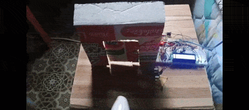
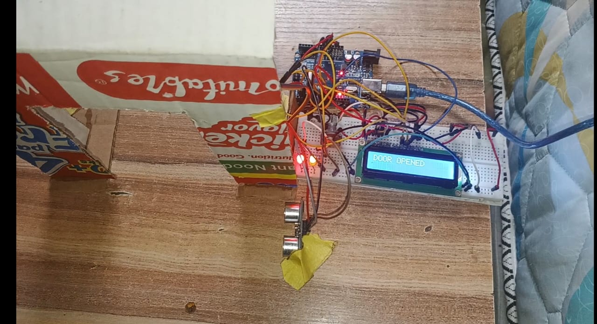
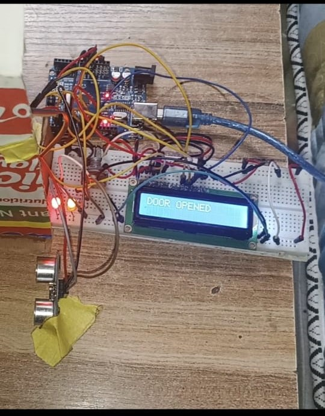
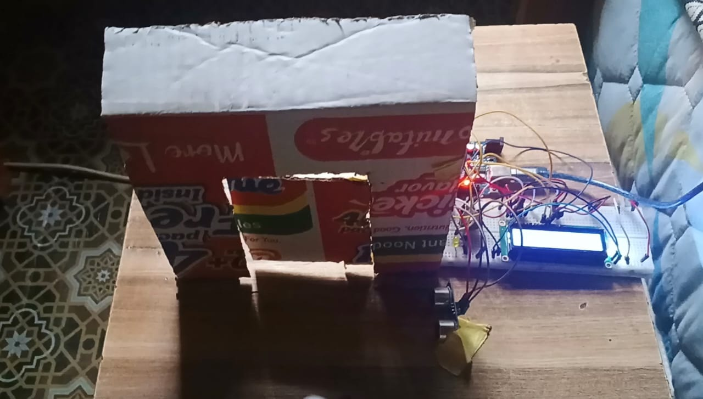
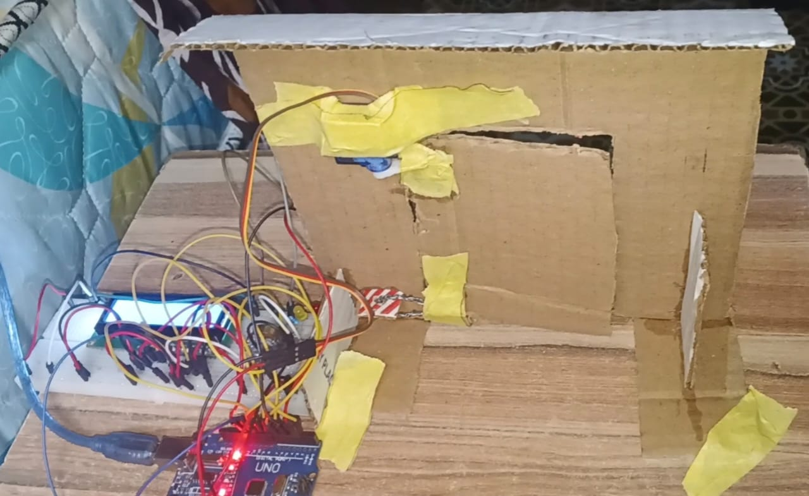

# Automatic Smart Door

An Arduino-based automatic door that detects a person approaching using ultrasonic sensing, opens via a servo motor, and closes automatically once the person moves away.

🎥 [Full project walkthrough](https://youtu.be/zbzhGsT8W_k?si=5MEKqlYiPALUNRWj)

## Problem / Goal

Standard doors require manual operation, which isn't ideal for hands-free or accessibility-focused use cases. The goal of this project was to build a working prototype of a door that opens automatically when someone approaches and closes once they've left the detection zone, using only basic embedded systems components — no pre-built automation kits.

## Design Decisions

- **HC-SR04 ultrasonic sensor** was chosen over a PIR motion sensor because it measures actual distance rather than just detecting motion, allowing a precise, adjustable trigger threshold rather than a fixed detection radius.
- **Servo motor (via the `Servo` library)** was used to physically pull/push the door open and shut, controlled directly from the Arduino based on the distance readings.
- **16x2 LCD display** was added to show live door status ("DOOR OPENED" / "DOOR CLOSED"), making it easy to demonstrate that the sensor and logic were working correctly in real time.
- **LED indicator** turns on whenever the door is open and turns off once it closes, giving a quick visual status check without needing to read the LCD.
- **Core logic:** continuously ping the ultrasonic sensor for distance; if distance is below 15 cm, open the servo to 90°, light the LED, and display "DOOR OPENED" on the LCD for a hold period; once distance is back at or above 15 cm, return the servo to 0°, turn off the LED, and display "DOOR CLOSED" on the LCD.
- **Trigger distance:** 15 cm suits the small cardboard prototype; a full-size door would need a longer range of around 100 cm.

## What Went Wrong and How I Fixed It

On initial power-up, the servo would jump open by itself and only then move to its intended starting position — even before any object was detected. This happened because the servo had no explicitly defined starting angle, so it powered on in an undefined/random position.

**Fix:** Added `myServo.write(0)` at the start of `setup()` to explicitly set the servo to a known closed angle (0°) immediately on power-up, before the main loop begins. This eliminated the erratic startup behavior entirely.

## Results

- The door opens when a person comes within the 15 cm trigger distance and closes once they move away.
- Servo startup behavior: fixed from an unpredictable jump to a clean, consistent closed position on every power cycle.

## Hardware Used

- Arduino Uno
- HC-SR04 ultrasonic distance sensor
- Servo motor (SG90)
- 16x2 LCD display
- LED indicator
- Cardboard door/frame prototype (proof-of-concept enclosure)
- Potentiometer (for LCD contrast adjustment)
- Jumper wires

## Pin Configuration

| Component         | Pin |
|-------------------|-----|
| Ultrasonic Trig   | 5   |
| Ultrasonic Echo   | 3   |
| Servo             | 6   |
| LED               | 2   |
| LCD RS            | 7   |
| LCD E             | 8   |
| LCD D4            | 9   |
| LCD D5            | 10  |
| LCD D6            | 11  |
| LCD D7            | 12  |

## How to Run

1. Wire the HC-SR04, servo, LCD, and LED to the Arduino Uno as shown in the images below (or per the pin table above).
2. Open `AUTOMATIC_SMART_DOOR.ino` in the Arduino IDE.
3. Select "Arduino Uno" as the board and the correct port under Tools.
4. Upload the sketch.
5. Approach the sensor within ~15 cm to see the door open (LED on, LCD reads "DOOR OPENED"); step away to see it close (LED off, LCD reads "DOOR CLOSED").

## Wiring and Prototype Photos

 

 
